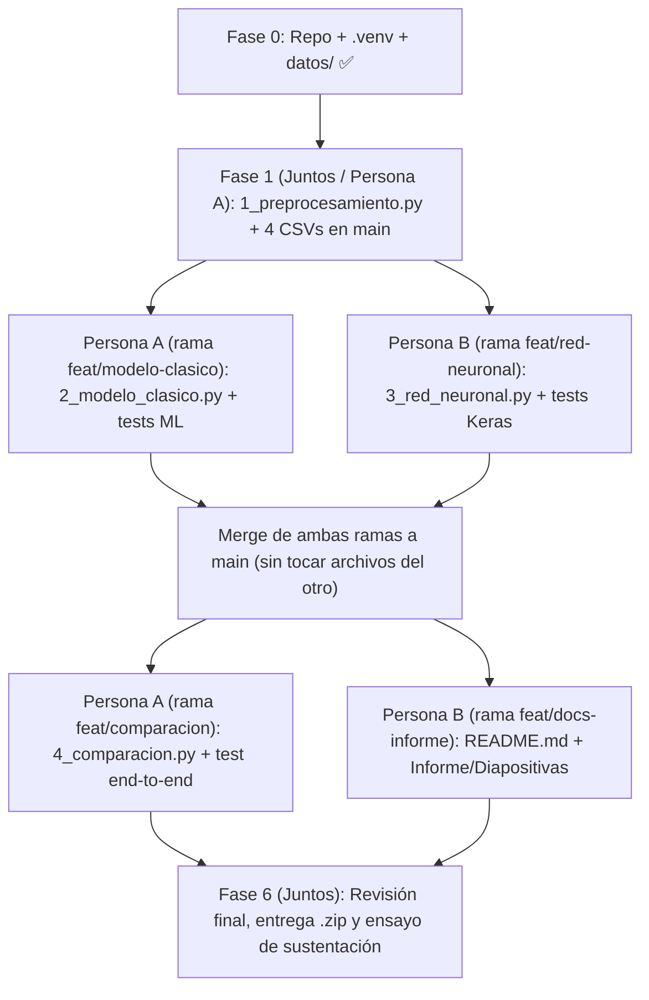

# 🗺️ Hoja de Ruta — Taller Final Integrador de Machine Learning (601)

> [!IMPORTANT]
> **Fecha límite de entrega y sustentación:** Martes **24 de noviembre de 2026 — hasta las 16:00 h** (Semana 15).  
> **Modalidad:** Equipo de 2 estudiantes (calificación individual en la sustentación oral de **5 a 8 minutos** por estudiante + demo en vivo desde terminal).  
> **Documento guía:** [Taller Final Integrador de Machine Learning 601.pdf](Taller%20Final%20Integrador%20de%20Machine%20Learning%20601.pdf)  
> **Repositorio remoto:** `https://github.com/Bonifacho/machine_lenin.git`

---

## 🎯 1. Definición del Problema y Dataset

- **Dataset:** `datos/datos_obesidad.csv` (**2,111 registros**, **17 columnas**: 16 variables de entrada + 1 objetivo, **0% de valores nulos**).
- **Nota del docente:** Se aprobó trabajar con las 16 variables de entrada y sin nulos; no es necesario eliminar columnas ni inyectar nulos artificialmente. Aun así, `1_preprocesamiento.py` incluirá `SimpleImputer` para cumplir rigurosamente la arquitectura del pipeline.
- **Tipo de problema:** **Clasificación Multiclase** (7 categorías en `NObeyesdad`):
  - `Insufficient_Weight`, `Normal_Weight`, `Overweight_Level_I`, `Overweight_Level_II`, `Obesity_Type_I`, `Obesity_Type_II`, `Obesity_Type_III`.
- **Variables de entrada (16):**
  - *Numéricas (8):* `Age`, `Height`, `Weight`, `FCVC`, `NCP`, `CH2O`, `FAF`, `TUE`.
  - *Categóricas (8):* `Gender`, `family_history_with_overweight`, `FAVC`, `CAEC`, `SMOKE`, `SCC`, `CALC`, `MTRANS`.
- **Pregunta de negocio propuesta (ajustable en consenso):**
  > *"¿Es posible clasificar con precisión el nivel de obesidad (`NObeyesdad`) de una persona a partir de sus características físicas, hábitos alimenticios y nivel de actividad física, comparando un modelo clásico de Machine Learning frente a una Red Neuronal?"*

---

## 📁 2. Estructura Final Exigida para la Entrega

La raíz del proyecto debe respetar exactamente esta jerarquía al momento de entregar el `.zip`:

```text
train_neural/
├── datos/
│   ├── datos_obesidad.csv      # Dataset original (ya ubicado ✅)
│   ├── X_train.csv             # Generado por 1_preprocesamiento.py
│   ├── X_test.csv              # Generado por 1_preprocesamiento.py
│   ├── y_train.csv             # Generado por 1_preprocesamiento.py
│   └── y_test.csv              # Generado por 1_preprocesamiento.py
├── 1_preprocesamiento.py       # Script 1: limpieza, encoding, escalado y split 80/20
├── 2_modelo_clasico.py         # Script 2: modelo Scikit-Learn y métricas
├── 3_red_neuronal.py           # Script 3: modelo TensorFlow/Keras y métricas
├── 4_comparacion.py            # Script 4: evaluación lado a lado (demo en vivo)
├── README.md                   # Documentación del problema, pipeline y conclusiones
├── requirements.txt            # Dependencias (pandas, scikit-learn, tensorflow)
└── HOJA_DE_RUTA.md             # Este plan de trabajo
```

> [!NOTE]
> Si durante el desarrollo creamos scripts auxiliares de pruebas (ej. `test_validacion.py`) o modelos guardados (`.keras` / `.joblib`), recuerda revisar al final si deben moverse a una carpeta temporal o excluirse del `.zip` final si el docente evalúa estrictamente la jerarquía del PDF.

---

## 👥 3. Dinámica de Trabajo en Equipo (Cómo dividirse sin estorbarse)

El cuello de botella natural del proyecto es **`1_preprocesamiento.py`**, porque define el formato exacto de `X_train.csv`, `X_test.csv`, `y_train.csv` e `y_test.csv` que consumen los demás scripts.

Por eso la mejor estrategia es **Fase secuencial inicial + Desarrollo en paralelo por archivo (0 conflictos)**:



### Reparto recomendado de responsabilidades

| Rol | Responsable | Archivos que posee (exclusividad) | Tareas clave |
| :--- | :--- | :--- | :--- |
| **Contrato de Datos (Previo)** | Ambos / Persona A | `1_preprocesamiento.py`, `datos/X_*.csv`, `datos/y_*.csv` | Cerrar primero el preprocesamiento y subir los 4 CSVs procesados a `main`. |
| **Integrante A (ML Clásico + Integración)** | Estudiante 1 | `2_modelo_clasico.py`, `4_comparacion.py` | Implementar modelo Scikit-Learn, pruebas de validación del modelo clásico y script comparativo final. |
| **Integrante B (Deep Learning + Documentación)** | Estudiante 2 | `3_red_neuronal.py`, `README.md`, Informe/Slides | Implementar Red Neuronal en TensorFlow/Keras, pruebas de validación Keras, `README.md` y presentación para sustentación. |

### Reglas de oro para no pisarse el código
1. **Un archivo = un dueño por rama:** Nunca edites `3_red_neuronal.py` si le toca a tu compañero (y viceversa), salvo revisión acordada después del merge.
2. **Contrato de interfaz desde el inicio:**
   - `y_train.csv` e `y_test.csv` tendrán **una sola columna entera (`NObeyesdad` codificada de `0` a `6`)**.
   - Ambos scripts (`2_modelo_clasico.py` y `3_red_neuronal.py`) deben poder ejecutarse de forma **independiente** (`python 2_modelo_clasico.py`), **y además** exponer una función limpia (por ejemplo `evaluar_modelo_clasico(...)` y `evaluar_red_neuronal(...)`) que devuelva un diccionario con `{accuracy, precision, recall, f1, y_pred, tiempo_entrenamiento}` para que `4_comparacion.py` los importe o ejecute sin duplicar código.
3. **Prohibido trabajar directo en `main` durante la fase paralela:** Cada módulo se desarrolla en su rama `feat/...` y se integra a `main` mediante Pull Request (o merge limpio).

---

## 🔀 4. Flujo de Trabajo Git Paso a Paso

### 4.1 Configuración inicial para el compañero (solo una vez)

```powershell
# 1. Clonar el repositorio
git clone https://github.com/Bonifacho/machine_lenin.git
cd machine_lenin

# 2. Crear entorno virtual con uv e instalar dependencias exactas
uv venv
.venv\Scripts\activate
uv pip install -r requirements.txt
```

> [!TIP]
> Si el compañero usa Git Bash en lugar de PowerShell, la activación es `source .venv/Scripts/activate`.

### 4.2 Ciclo diario de trabajo (para ambos)

**Paso 1 — Siempre empezar sincronizando `main`:**
```powershell
git checkout main
git pull origin main
```

**Paso 2 — Crear rama propia para la tarea asignada:**
```powershell
# Ejemplo Integrante A:
git checkout -b feat/modelo-clasico

# Ejemplo Integrante B:
git checkout -b feat/red-neuronal
```

**Paso 3 — Trabajar, probar en local y hacer commits pequeños y descriptivos:**
```powershell
git status
git add 2_modelo_clasico.py
git commit -m "feat: implementar RandomForest en 2_modelo_clasico.py con métricas multiclase"
```

**Paso 4 — Subir la rama al repositorio remoto:**
```powershell
git push -u origin feat/modelo-clasico
```

**Paso 5 — Integrar a `main` (vía Pull Request en GitHub):**
1. En GitHub, abrir un **Pull Request (PR)** de `feat/modelo-clasico` → `main`.
2. El otro compañero revisa rápido (o verifica que el script corra sin errores) y aprueba el **Merge Pull Request**.
3. Ambos actualizan su `main` local antes de iniciar la siguiente tarea:
   ```powershell
   git checkout main
   git pull origin main
   git branch -d feat/modelo-clasico   # Limpia la rama local ya fusionada
   ```

**Paso 6 — ¿Qué hago si `main` avanzó mientras yo estaba en mi rama?**
```powershell
git checkout main
git pull origin main
git checkout mi-rama-actual
git merge main
# Si no tocaron los mismos archivos, Git fusionará automáticamente sin conflictos.
```

---

## 📋 5. Plan Detallado Paso a Paso (Fases 0 a 6)

### ✅ Fase 0: Preparación del Entorno y Repositorio *(Completado)*
- [x] Lectura y análisis de requisitos en [Taller Final Integrador de Machine Learning 601.pdf](Taller%20Final%20Integrador%20de%20Machine%20Learning%20601.pdf).
- [x] Inspección de [datos/datos_obesidad.csv](datos/datos_obesidad.csv) (2,111 filas, 16 features, 7 clases, 0% nulos).
- [x] Inicialización del repo Git (`main`) con `.gitignore` y remoto en GitHub.
- [x] Creación del entorno `.venv` con `uv` (Python 3.11.14) e instalación de `pandas`, `scikit-learn` y `tensorflow`.
- [x] Reubicación del dataset en `datos/datos_obesidad.csv` y creación de `requirements.txt`.

---

### ✅ Fase 1: Preprocesamiento de Datos (`1_preprocesamiento.py`) *(Completado)*
**Responsable:** Ambos (o Integrante A) en rama `feat/preprocesamiento` → Merge a `main`.

#### Tareas de implementación
- [x] Cargar `datos/datos_obesidad.csv` usando `pathlib.Path` (para que funcione sin importar desde dónde se ejecute).
- [x] Separar características `X` (16 columnas) y variable objetivo `y` (`NObeyesdad`).
- [x] Codificar la variable objetivo `y` de texto a enteros `0..6` mediante diccionario ordenado clínico (`MAPEO_CLASES`) e imprimir en consola el mapeo exacto clase ↔ número.
- [x] Dividir en **80% Train / 20% Test** con **`random_state=412`** (exigido por el taller) y `stratify=y` (para mantener la proporción de las 7 clases en Train y Test).
- [x] Identificar columnas numéricas (8) y categóricas (8) en `X`.
- [x] **Imputación (`SimpleImputer`):**
  - Numéricas: `SimpleImputer(strategy="median")` (*fit* sobre `X_train`, *transform* sobre `X_train` y `X_test` para evitar fuga de datos).
  - Categóricas: `SimpleImputer(strategy="most_frequent")` (*fit* sobre `X_train`, *transform* sobre `X_train` y `X_test`).
- [x] **Codificación One-Hot:** Aplicar `pd.get_dummies(..., drop_first=True, dtype=int)` asegurando que `X_train` y `X_test` queden exactamente con las mismas columnas y en el mismo orden (`X_test.reindex(columns=X_train.columns, fill_value=0)`).
- [x] **Escalado numérico (`StandardScaler`):** Ajustar (`fit_transform`) sobre las 8 columnas numéricas de `X_train` y transformar (`transform`) sobre `X_test`.
- [x] Exportar los 4 archivos a `datos/`:
  - `datos/X_train.csv`
  - `datos/X_test.csv`
  - `datos/y_train.csv`
  - `datos/y_test.csv`

#### 🧪 Tests de validación de Fase 1 (ejecutar antes del merge a `main`)
Correr `python 1_preprocesamiento.py` y verificar con un script rápido o comando en terminal que:
- [x] Existen los 4 archivos en `datos/` y no están vacíos.
- [x] **Split exacto 80/20:** `X_train` tiene 1,688 filas y `X_test` tiene 423 filas; `len(X_train) == len(y_train)` y `len(X_test) == len(y_test)`.
- [x] **Cero valores nulos:** `isna().sum().sum() == 0` en los 4 CSVs.
- [x] **Columnas alineadas:** `list(X_train.columns) == list(X_test.columns)` y todos los `dtypes` son numéricos (`int`/`float`, sin columnas `object` ni `bool` sueltas).
- [x] **Escalado correcto:** En `X_train`, las 8 columnas numéricas tienen media ≈ `0.0` y desviación estándar ≈ `1.0`.
- [x] **Objetivo válido:** `y_train` e `y_test` contienen exactamente las 7 clases (`0` a `6`) en proporciones similares.

> [!IMPORTANT]
> Una vez pasen todos estos checks, hacer commit de `1_preprocesamiento.py` **y de los 4 CSV generados en `datos/`** hacia `main`. A partir de este momento, Integrante A e Integrante B trabajan en paralelo.

---

### ✅ Fase 2: Modelo Clásico con Scikit-Learn (`2_modelo_clasico.py`) *(Implementado en `feat/modelo-clasico` — pendiente merge a `main`)*
**Responsable:** Integrante A en rama `feat/modelo-clasico`.

#### Tareas de implementación
- [x] Cargar `datos/X_train.csv`, `datos/X_test.csv`, `datos/y_train.csv`, `datos/y_test.csv`.
- [x] Seleccionar y entrenar un modelo de clasificación multiclase de Scikit-Learn con `random_state=412` (`RandomForestClassifier(n_estimators=200, max_depth=12, min_samples_leaf=2, random_state=412)`).
- [x] Generar predicciones sobre `X_train` (control de overfitting) y sobre `X_test`.
- [x] Calcular e imprimir de forma limpia en consola:
  - **Accuracy** (Train `99.47%` vs Test `93.85%`).
  - **Precision** (`average="weighted"` → `94.39%`).
  - **Recall** (`average="weighted"` → `93.85%`).
  - **F1-Score** (`average="weighted"` → `93.97%`).
  - **Matriz de Confusión (7×7)** y `classification_report`.
- [x] Encapsular la lógica en `evaluar_modelo_clasico(verbose=True)` manteniendo el bloque `if __name__ == "__main__":`.

#### 🧪 Tests específicos para el modelo de Machine Learning (Scikit-Learn)
Antes de hacer Pull Request a `main`, verificar:
- [x] **Test de ejecución limpia:** `python 2_modelo_clasico.py` termina con código `0` sin warnings críticos.
- [x] **Test de formato de predicciones:** `y_pred.shape == (423,)` y clases en `{0..6}`.
- [x] **Test de línea base (Sanity Check):** Accuracy `93.85%` y F1 `93.97%` (> 85%).
- [x] **Test de generalización (Overfitting):** Brecha Train vs Test de `5.61%` (`< 8%`).
- [x] **Test de determinismo:** Ejecuciones consecutivas producen exactamente las mismas predicciones.
- [x] **Test de inferencia individual:** `predict_proba` sobre 1 fila devuelve `(1, 7)` con suma `= 1.0`.

---

### ✅ Fase 3: Red Neuronal con TensorFlow/Keras (`3_red_neuronal.py`) *(Completado y fusionado en `main`)*
**Responsable:** Integrante B en rama `feat/red-neuronal`.

#### Tareas de implementación
- [x] Fijar semilla de reproducibilidad al inicio: `tf.keras.utils.set_random_seed(412)`.
- [x] Cargar `datos/X_train.csv`, `datos/X_test.csv`, `datos/y_train.csv`, `datos/y_test.csv`.
- [x] Construir arquitectura `tf.keras.Sequential`:
  - `Input(shape=(23,))` → `Dense(64, relu)` → `Dense(32, relu)` → `Dense(7, softmax)`.
- [x] Compilar con `Adam(learning_rate=0.001)`, `sparse_categorical_crossentropy` y `metrics=["accuracy"]`.
- [x] Entrenar 30 épocas con `validation_split=0.2` monitoreando `loss` y `accuracy`.
- [x] Evaluar sobre `X_test` e imprimir `loss` (`0.2100`), **Accuracy** (`93.85%`), **Precision** (`93.96%`), **Recall** (`93.85%`) y **F1-Score** (`93.88%`).
- [x] Encapsular en `evaluar_red_neuronal(verbose=True)` manteniendo `if __name__ == "__main__":`.

#### 🧪 Tests específicos para la Red Neuronal (TensorFlow/Keras)
Antes de hacer Pull Request a `main`, verificar:
- [x] **Test de forma de salida y clases:** `y_pred` de forma `(423,)` con clases en `{0..6}` desde capa `Softmax(7)`.
- [x] **Test de convergencia del entrenamiento:** `loss` bajó de `1.8437` a `0.0664` (`val_loss` de `1.6554` a `0.1541`) sin `NaN`.
- [x] **Test de desempeño mínimo (Sanity Check):** Accuracy `93.85%` y F1 `93.88%` (> 85%–90%).
- [x] **Test de determinismo y tipos:** Entrada `float32` sin errores y resultado idéntico entre ejecuciones consecutivas.

---

### ✅ Fase 4: Comparación Final (`4_comparacion.py`) *(Completado en `feat/comparacion`)*
**Responsable:** Integrante A en rama `feat/comparacion` (luego del merge de Fases 2 y 3).

#### Tareas de implementación
- [x] Cargar el conjunto de prueba no visto (`datos/X_test.csv`, `datos/y_test.csv`).
- [x] Obtener las métricas de ambos modelos sobre **exactamente el mismo `X_test` e `y_test`** mediante `importlib.import_module("2_modelo_clasico")` y `importlib.import_module("3_red_neuronal")`.
- [x] Imprimir en consola un **cuadro comparativo limpio en formato tabla** lado a lado con `Accuracy`, `Precision (weighted)`, `Recall (weighted)`, `F1-Score (weighted)` y `Tiempo entrenamiento`.
- [x] Imprimir automáticamente la **conclusión técnica**: Random Forest ganó por F1-Score (`93.97%` vs `93.88%`) y entrenó ~`9.1x` más rápido (`1.00 s` vs `9.12 s`), con `91.49%` de acuerdo entre predicciones.

#### 🧪 Tests de integración y demo en vivo (Fase 4)
- [x] **Test end-to-end en frío:** Los 4 scripts (`1_` a `4_`) ejecutados en esta sesión con código de salida `0`.
- [x] **Test de consistencia:** Las métricas impresas por `4_comparacion.py` coinciden exactamente con las reportadas por `2_modelo_clasico.py` y `3_red_neuronal.py` (`93.85%` Acc en ambos; F1 `93.97%` vs `93.88%`).
- [x] **Test de tiempo de demo en vivo:** Entrenamiento conjunto ~`10.1 s` (en OneDrive el arranque inicial de TensorFlow tarda ~`44 s`, total en frío ~`54.6 s`).

---

### ✅ Fase 5: `README.md` e Informe/Presentación *(Completado)*
**Responsable:** Integrante B en rama `feat/docs-informe` (en paralelo con Fase 4).

- [x] Redactar `README.md` completo con:
  - Pregunta de negocio y descripción del dataset (`datos_obesidad.csv`).
  - Decisiones de preprocesamiento (`SimpleImputer`, One-Hot Encoding, `StandardScaler`, split 80/20 `random_state=412`).
  - Instrucciones de instalación (`uv`) y ejecución de los 4 scripts.
  - Tabla de resultados comparativos y conclusiones técnicas.
- [x] Preparar el informe/diapositivas para la sustentación (`Presentación taller ML obesidad.pptx` auditada y verificada al 100%, cubriendo: contexto de negocio, preprocesamiento, Scikit-Learn vs TensorFlow, métricas y conclusión).

---

### 🎤 Fase 6: Verificación Final, Empaquetado y Ensayo de Sustentación *(Lista técnica completada ✅ — falta ensayo/exposición)*
**Responsable:** Ambos (juntos antes del **24 de noviembre, 16:00 h**).

- [x] Verificar que **no hay cuadernos `.ipynb`** en la entrega (`IPYNB_COUNT: 0`).
- [x] Verificar que la estructura final coincide exactamente con la del PDF (`datos/` con los 5 CSVs + `1_` a `4_` + `README.md` + `requirements.txt` + `Presentación taller ML obesidad.pptx`).
- [x] Comprimir la carpeta del proyecto (`entrega_taller_ml_601.zip`, `579,836 bytes`, excluyendo `.venv/`, `__pycache__/` y guías internas).
- [x] Hacer una **prueba limpia** descomprimiendo el `.zip` en otra carpeta y ejecutando `python 4_comparacion.py` desde cero (`exit code 0`).
- [ ] Ensayar la sustentación oral (**5 a 8 minutos por estudiante**) usando `GUIA_SUSTENTACION.md`, repartiendo quién explica qué y repasando el banco de preguntas del docente.
